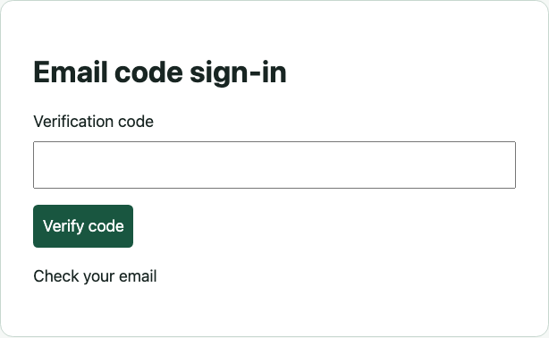
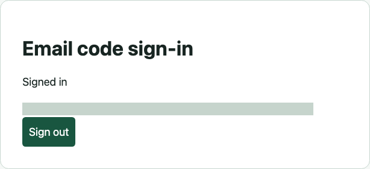
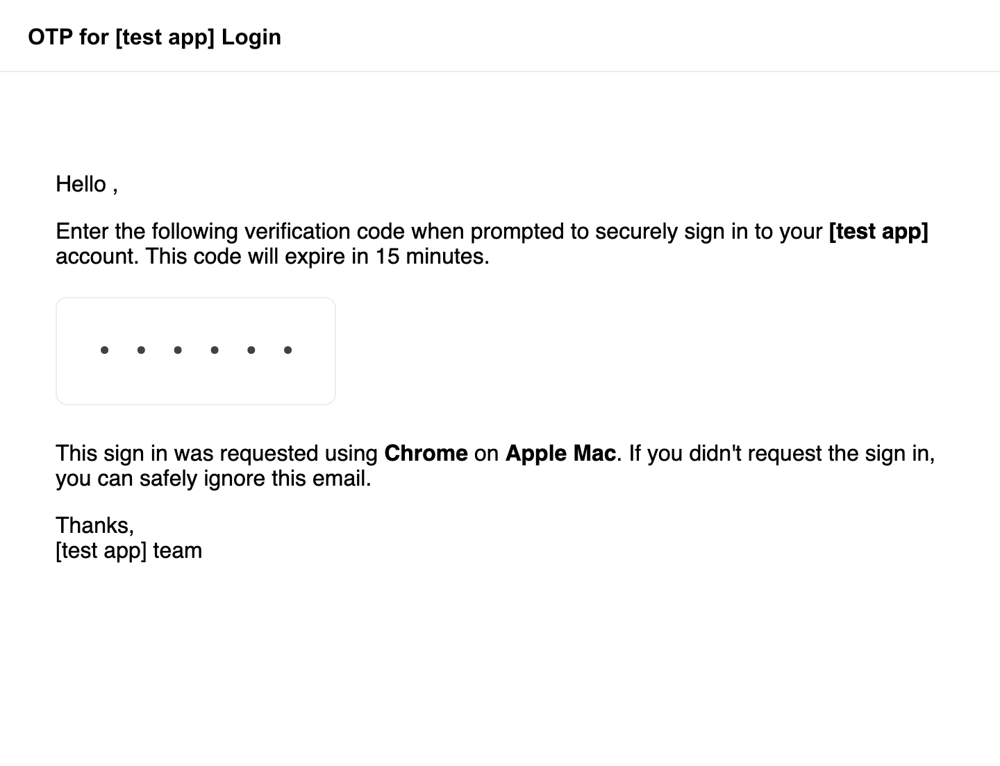
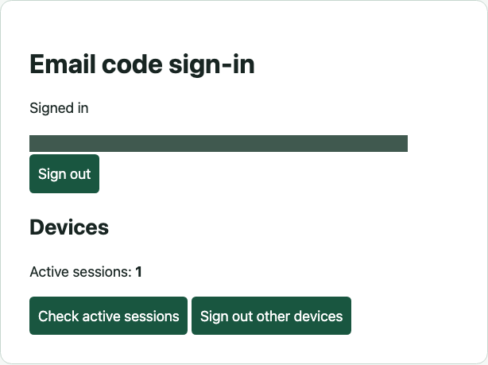

# Test Appwrite email OTP sign-in with Playwright

An email code can reach the right inbox and still fail at sign-in. Appwrite needs the code and the user ID from the original challenge. The last step of this test reloads the app and reads the signed-in account from Appwrite, so you can tell whether the browser actually kept the session.

The sample has two forms. The first asks where to send the code. The second accepts the six digits from the email. Playwright drives both forms. On the Node side, MailSlurp creates a fresh inbox for the run and reads the message Appwrite delivers to it. [Appwrite email OTP](https://appwrite.io/docs/products/auth/email-otp)

## Connect your staging project

In the Appwrite console, create a project and copy its project ID and regional API endpoint. Under **Apps**, register a Web app with `localhost` as its hostname. In **Auth**, enable **Email OTP**. The standard Appwrite Cloud email template works with the six-digit parser in this example.

Use Node 22.12 or newer. Put the endpoint, project ID and MailSlurp API key in the sample's `.env.local`. The two `VITE_` settings identify the public Appwrite project. The test runner reads the unprefixed MailSlurp key.

```sh
npm ci
npx playwright install chromium
cp .env.example .env.local
# Fill in .env.local, then run:
npm test
```

## Follow one challenge from inbox to account

When the user submits an address, the [browser app](app.js) asks Appwrite for an email token. Keep the ID Appwrite returns. A returning email address can already belong to an account, in which case Appwrite uses its existing ID.

```js
const token = await account.createEmailToken({
  userId: ID.unique(),
  email: request.elements.email.value
});
challengedUser = token.userId;
```



The [Playwright test](test/staging.spec.js) waits for the message in the inbox created for this run. It reads the message as text and accepts one distinct six-digit value. If you include another six-digit number in your template, narrow the extraction to the line containing your verification instructions. Keeping codes as strings preserves leading zeroes.

```js
const message = await mail.waitForLatestEmail(inbox.id, 90000, true);
const { lines } = await mail.emailController.getEmailTextLines({ emailId: message.id });
const codes = new Set(lines.join('\n').match(/\b\d{6}\b/g));
```

Once Playwright enters the code, the app calls `account.createSession({ userId: challengedUser, secret })` and `account.get()`. The test reloads, compares the account email with the test inbox address, and signs out. A rejected code and a session that disappears on reload show up at different steps.



### What should be included in an OTP email to ensure user trust?

Name the app and the action that prompted the email, make the code easy to find, state when it expires, and tell the recipient what to do if they didn't request it. The Appwrite message in our test included a 15-minute expiry and identified the browser and operating system that initiated sign-in. If you customize your template, check those details against the actual request and configured expiry. Wording alone can't authenticate a sender.



If the first request fails before any email arrives, check the regional endpoint, registered hostname and Email OTP setting. If sign-in succeeds but the reload loses the account, inspect browser storage and the Appwrite session request on your staging origin. The test deletes its inbox. Appwrite retains the user record, so run it in a project where test users can be removed periodically. For the corresponding SMS journey, see [Appwrite phone sign-in](https://appwrite.io/docs/products/auth/phone-sms).

## Sign a shared device out remotely

Run `npm test -- --grep 'sign out other devices'` for the two-session check. It requests two independent codes for the same disposable email address and signs in from two isolated Playwright contexts. In the first browser the test lists sessions, requires two entries, and chooses **Sign out other devices**. After reload, the second browser must show **Signed out** and the first must still display the expected email and one remaining session. The app uses `account.deleteSessions({ current: false })` for remote sign-out and `deleteSession({ sessionId: 'current' })` for ordinary sign-out. Set `SCREENSHOT_DIR` to an output directory to capture the device count before and after, with the address masked.


