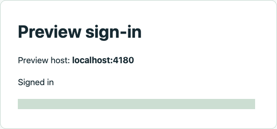
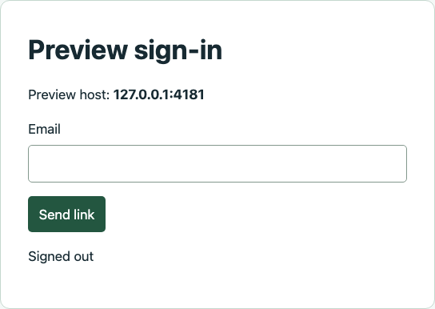

# Check which preview a Better Auth magic link signs you into

Suppose two pull requests each have a working sign-in form. Both send email. If one preview inherits the other's base URL, clicking the link can sign the tester into the wrong build. A green result that only checks for a success screen can miss the mistake.

This example starts two copies of a small Better Auth app, sends an email from each and opens both delivered links in Chromium. For each link, it checks the host before navigation, reads the account from the issuing server, then asks the other server for the same account in the same browser context. MailSlurp supplies the test inboxes and sends the messages through its HTTPS API.

## Run the example on two local hosts

Use Node 22.13 or newer with built-in SQLite support. Copy `.env.example` to `.env.local` and set `MAILSLURP_API_KEY`. Leave the other fields blank for the local test. The account needs permission to create and delete temporary inboxes, send mail, and read the messages it receives.

```sh
npm ci
npx playwright install chromium
npm test
```

The [test](test/preview.spec.js) starts one app at `http://localhost:4180` and another at `http://127.0.0.1:4181`. Using different hostnames matters because browser cookies can span ports on the same hostname. Each server gets its own SQLite database and signing secret. Each recipient has a fresh browser context. The test closes the servers and removes the mailboxes when it finishes.

## Check the destination before following the link

The [server](preview.js) sets Better Auth's `baseURL` to its own origin. Its sign-in form requests `/account` as the callback. The magic-link plugin passes the resulting verification URL to a mail function that sends it to the assigned test inbox. [Better Auth magic links](https://better-auth.com/docs/plugins/magic-link)

The runner reads the email and selects the link whose path is `/api/auth/magic-link/verify`. Before consuming it, the runner checks both the origin and the callback. A link back to the main site already tells you which setting to inspect, even when that main site could complete a valid sign-in.

After the click, the browser reaches `/account`. The home page displays the preview hostname and reads its account from this route. The route reads the browser's cookie with `auth.api.getSession()` on the server. After a reload, the issuing preview must return HTTP 200 and the exact test email. The other preview must return HTTP 401. The test repeats this in the other direction with a different inbox.

## Apply the check to Railway previews

The runnable test uses local hosts. For an existing Railway preview environment, [the server entry point](server.js) can derive the external HTTPS origin from `RAILWAY_PUBLIC_DOMAIN` and listen on Railway's `PORT`. Give each preview its own secret. Check that its public domain has been generated and belongs to that preview before requesting a link. Railway documents the setup for PR environments and the outbound mail options for each plan. [Railway environments](https://docs.railway.com/environments) · [Outbound networking](https://docs.railway.com/networking/outbound-networking)

To start one instance manually, set these variables and run `npm start`. Use an isolated MailSlurp testing workspace. The instance accepts mail delivery only for its configured recipient.

| Variable | Value |
| --- | --- |
| `PREVIEW_ORIGIN` | Exact external origin with no trailing slash. Omit on Railway to use that preview's generated public domain. |
| `PORT` | Listening port. The local default is 4180. |
| `BETTER_AUTH_SECRET` | A separate cryptographically random secret of at least 32 characters for this instance. |
| `MAILSLURP_SENDER_KEY` | An Agent Responder key scoped to this preview's sender inbox. The hosted app uses it to create and send the sign-in message. Keep the runner's workspace key on the runner. |
| `SENDER_INBOX_ID` | ID of a MailSlurp inbox that can send email. |
| `TEST_RECIPIENT` | Address of the one test inbox allowed to receive this preview's sign-in emails. |

The example keeps its database in memory. Restarting an instance clears its test users and invalidates its sessions. If you need sessions to survive restarts or move between replicas, give that preview its own persistent authentication database.

### Run the same assertions against two hosted previews

Start the sample in two preview environments. Give each one its own `TEST_RECIPIENT` and supply the matching MailSlurp inbox IDs to the runner as `TEST_INBOX_ID_A` and `TEST_INBOX_ID_B`. Set `PREVIEW_ORIGIN_A` and `PREVIEW_ORIGIN_B` to their HTTPS origins, with no trailing slash. From the example directory run:

```sh
npm run test:hosted
```

The hosted runner uses the same [browser and session assertions](test/check-preview.js) as the local pair. It waits for a message received since the current request and leaves the two configured inboxes available for the next run. Reserve each inbox for one job at a time.

## Recognize the wrong preview in the browser



The address on the account screen is masked in this screenshot. The test compares it with the exact inbox used to request the link. Visiting the other preview in the same browser must return HTTP 401 and show its sign-in form. The screenshots are from the local pair. On Railway the generated HTTPS domains take the place of these two hostnames.


