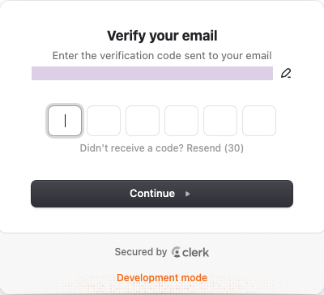

# Test Clerk email verification with Playwright

Clerk supplies the sign-up form and sends the verification email. A successful signup with Clerk's fixed development code can still pass when your users never receive a message. This example runs both paths against a Next.js app. The live test creates a MailSlurp inbox, enters the six digits found in its message, and checks the verified primary email on a server-rendered account page after reload.

## Setup

1. Install Node.js 22.13 or newer. Use a dedicated Clerk development instance configured for sign-up with an email address and email verification code. The example supports an optional password field. Leave additional required profile fields off for this sample.
2. From this directory run:

   ```sh
   npm ci
   npx playwright install chromium
   cp .env.example .env.local
   ```

3. Set `NEXT_PUBLIC_CLERK_PUBLISHABLE_KEY` and `CLERK_SECRET_KEY` to **development** keys from the same application. Alternatively, `npx -y clerk@latest init --framework next --accountless --no-skills` can provision development keys locally. Keep the resulting `.clerk/` directory and `.env.local` private. Add `MAILSLURP_API_KEY` to that file for the real-email test. Use a MailSlurp account that can create, read, and delete inboxes.
4. Run one or both paths:

   ```sh
   npm test -- --grep 'reserved test'
   npm test -- --grep 'real signup'
   npm test
   ```

Playwright starts the app at `http://localhost:4192`. To try it manually, start `npm run dev` and visit `/sign-up`.

## What the assertions prove

Both tests try the protected `/account` route as a guest. Clerk's signup component opens. The reserved identity uses Clerk's documented fixed code. The real signup records the submit time, waits for a message in its own inbox, extracts the six digits, and enters them into the same form. Neither test creates a session through an admin sign-in shortcut.



After reload, the server calls `currentUser()`. Playwright verifies both the exact primary email and its `verified` status. A redirect to the account page alone would miss a wrong identity. See the [test](test/signup.spec.js) and [server-side account page](app/account/page.jsx).

The live test deletes its inbox. Both paths create users in your Clerk development instance. Development email-recipient limits apply to real email. If you enable a required username, phone, or other field, adapt the test to the form you actually show.

[Clerk's sign-up testing guide](https://clerk.com/docs/guides/development/testing/playwright/test-sign-up-flows) · [Test addresses and limits](https://clerk.com/docs/guides/development/testing/test-emails-and-phones)
