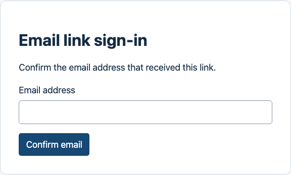

# Verify Firebase email-link sign-in in a fresh browser

A Firebase app can remember the sign-in email in local storage. Opening the email in a different browser loses that value. This example requests an email in Chromium, opens the actual Firebase link in an isolated context, prompts for the original address, and verifies which browser acquires the session.

## Setup

1. Use Node.js 22.13 or newer. Create a Web app in a dedicated Firebase project. Under Authentication enable **Email/Password** and **Email link (passwordless sign-in)**. Add `localhost` under Authentication's **Authorized domains**. Use the default Firebase action handler and an email sender that can deliver to test addresses.
2. In this directory run:

   ```sh
   npm ci
   npx playwright install chromium
   cp .env.example .env.local
   ```

3. Copy the web configuration values into `VITE_FIREBASE_API_KEY`, `VITE_FIREBASE_AUTH_DOMAIN` and `VITE_FIREBASE_PROJECT_ID`. The auth domain must match the domain of the links your Firebase email template sends. Set `MAILSLURP_API_KEY` to a key that can create, read, and delete inboxes. Keep this value on the test runner.
4. Run `npm test`. Playwright starts Vite on `http://localhost:4193`. To use the forms by hand, run `npm run dev`.

## Follow the real action link

The [app](app.js) sends a link with `handleCodeInApp: true` and the app's origin as the continue URL. The [test](test/email-link.spec.js) waits for the message in a new inbox and validates the action host, path, mode, one-time code and continue URL before following it. A new browser context starts without the requesting browser's storage. The user enters the original address and the app calls `signInWithEmailLink`.



After reload the receiving browser shows the expected email, while the requesting browser is still signed out. The runner signs out and deletes the inbox. Firebase retains the test user. Real link sends count against the project's email-link quota. The example uses Firebase's default web handler; adapt the link selector if you configure a custom handler.

[Firebase web email-link authentication](https://firebase.google.com/docs/auth/web/email-link-auth) · [Firebase Auth limits](https://firebase.google.com/docs/auth/limits)
