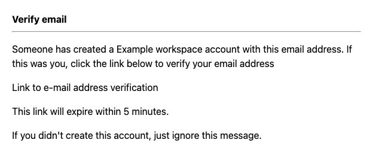
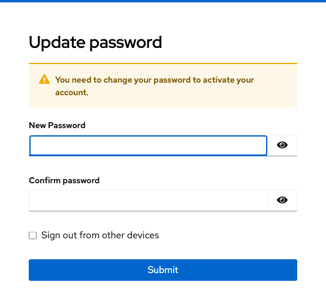
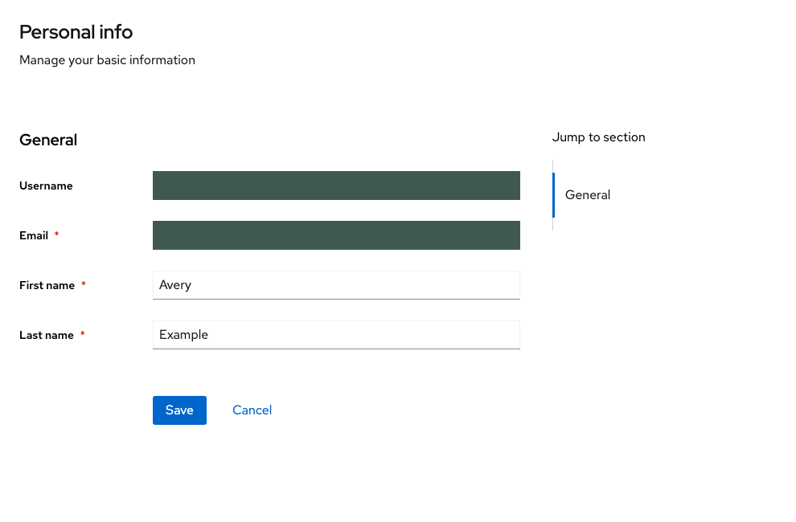

# Test Keycloak email verification with Playwright and MailSlurp

Keycloak can create a user before the user has verified their email. This example registers through Keycloak's account console, checks the stored user's verification flag, opens the link delivered over SMTP, and signs in again from an empty browser context.

## Setup

Use macOS or Linux with Node.js 22.13+, OpenJDK 25, and a dedicated [Keycloak 26.8.2 distribution](https://github.com/keycloak/keycloak/releases/tag/26.8.2). Extract the archive, then open this example directory. Use a MailSlurp account that can create inboxes, send through authenticated SMTP, and receive and read email.

```sh
npm ci
npx playwright install chromium
cp .env.example .env.local
```

Set `KC_HOME` to the extracted directory containing `bin/kc.sh`. Set `MAILSLURP_API_KEY` in the local file or runner environment. The runner provides the sender's inbox-specific credentials to the test realm. The MailSlurp API key stays on the Node runner.

## Run

```sh
npm test
```

Playwright starts Keycloak on `127.0.0.1:38761` and waits for the master realm discovery endpoint. Leave that port free. The example uses an in-memory database, a disposable local admin account and a fresh realm with self-registration and email verification enabled. It exercises the account console bundled with Keycloak; no separately hosted application or public callback is needed.

The browser registers one recipient. The runner reads the matching user record, requires `emailVerified === false`, and retrieves the verification URL from an email received in that inbox after registration. It accepts one distinct action-token URL on the expected Keycloak origin and realm. With the default Keycloak 26.8.2 flow, the registration form has no password field. After following the link, the test requires the same user ID and `emailVerified === true`, sets a password on the resulting form, and enters the account console. Another browser signs in with that password, reloads the account page, and must see the original address.

Set `SCREENSHOT_DIR` to an output directory to save a local rendering of the delivered email and screenshots of the verification, password setup, and account screens. Leave browser traces off when working with live one-time links. The runner deletes the two inboxes on completion; both also have a one-hour expiry. Stopping the local server discards its realm and user.

If no message arrives, check whether the browser reached the email-verification step and whether the local Keycloak server could connect to the SMTP host. The message contains a loopback URL: open it in the runner's browser on that machine. A mail app on a phone would resolve loopback to the phone.

[Keycloak local server quickstart](https://www.keycloak.org/getting-started/getting-started-zip) · [Keycloak server administration](https://www.keycloak.org/docs/latest/server_admin/) · [MailSlurp](https://www.mailslurp.com/)






