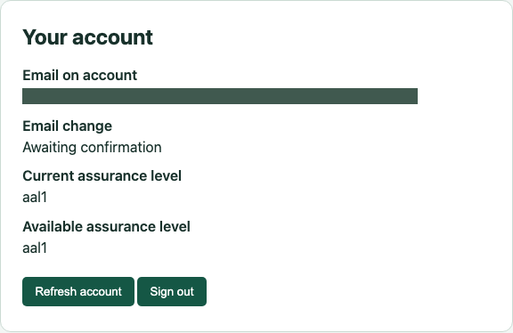
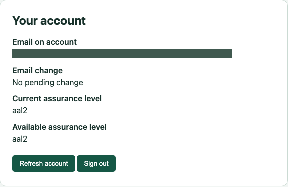

# Test Supabase account settings with Playwright

This staging app exercises two changes to an existing Supabase account. The email-change test opens separate messages delivered to the current and proposed addresses. The MFA test enrolls an authenticator, starts a fresh password session, submits a new code and reads the resulting assurance level after reload.

## Setup

1. Use Node.js 22.13 or newer and a dedicated Supabase test project. Enable email/password signup, email confirmation, **Secure email change**, and both TOTP enrollment and verification. Configure a custom SMTP sender permitted to send to your test addresses. Use the standard Supabase confirmation-link templates. Allow `http://localhost:3000/` in the project's redirect URLs.
2. From this directory run `npm ci`, `npx playwright install chromium`, and `cp .env.example .env.local`.
3. Set `VITE_SUPABASE_URL` and `VITE_SUPABASE_PUBLISHABLE_KEY` in the local file. Supply `MAILSLURP_API_KEY` to the Node runner using the same file or an environment variable. Use an account with inbox creation, message reading and deletion. The MFA test also needs virtual authenticator creation, code retrieval and deletion. Keep the MailSlurp key on the runner. No Supabase admin key is required.

## Run

```sh
npm test -- --grep 'secure email change'
npm test -- --grep 'returning account'
# Or run both in sequence:
npm test
```

Playwright starts Vite on localhost:3000. Use this port exclusively while running the suite. Run `npm run dev` separately if you want to try the forms by hand.

### Change the account email

The test signs up with a new inbox and follows the signup confirmation. It requests a change to a second inbox, reads the two distinct Supabase verification URLs, and opens the current address's link first. It reloads the original account and checks that the change is pending. It opens the second link, then signs in from a fresh context with the replacement address and original password and checks the immutable user ID. The test waits 65 seconds after signup before requesting more email. Override `AUTH_EMAIL_COOLDOWN_SECONDS` if your project uses a different interval.



### Return with a TOTP factor

Playwright enrolls a factor through the app. The runner passes its enrollment URI to a MailSlurp virtual MFA device, enters the first code, and signs out. A fresh context checks that password sign-in gives current level `aal1` and available level `aal2`. It waits for a different code, submits it, and verifies that the same account retains `aal2` after reload. To test your own authorization policy, add an assertion for the protected operation in each session state.



### Test data

Temporary inboxes expire after one hour and the runner deletes them on completion. The MFA test also deletes its virtual authenticator. The confirmed users and enrolled Supabase factors remain in your staging project. If you want masked images of the assertions, set `SCREENSHOT_DIR` to an output directory. Keep traces, raw email links, QR images and authenticator URIs out of source control.

[Supabase email changes](https://supabase.com/docs/reference/javascript/auth-updateuser) · [Supabase authenticator guide](https://supabase.com/docs/guides/auth/auth-mfa/totp) · [MailSlurp](https://www.mailslurp.com/)
