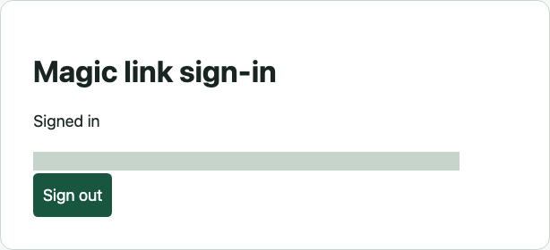
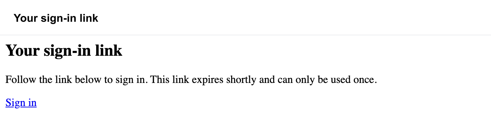

# Test a Supabase magic link with a real inbox and Playwright

A new user and a returning user can enter the same address on the same sign-in form and receive different messages. Supabase can send a signup confirmation for the first request. After the account exists, it sends a magic link. A test that creates a fresh address every time can pass for weeks without checking the message your returning users receive.

This example takes one address through both journeys. Playwright requests the link from a small browser app. MailSlurp gives the test its own email address and lets it read the delivered message from Node. After each click, the app asks Supabase who is signed in, then does it again after a reload. A separate browser context opens the same app to check that a visitor without the session still sees the sign-in form.

## Give the staging project an email sender

Use a dedicated Supabase project with email sign-in and new-user signups enabled. Set the Site URL to `http://localhost:3000` and allow `http://localhost:3000/` as a redirect URL. Keep the standard confirmation links in the **Confirm signup** and **Magic link** email templates. This example expects a link to the project's verification endpoint in both messages. [Passwordless email sign-in](https://supabase.com/docs/guides/auth/auth-email-passwordless) · [Redirect URLs](https://supabase.com/docs/guides/auth/redirect-urls)

Supabase's default sender restricts recipients to project organization members. To reach each new test address, open **Authentication > Emails > SMTP Settings** and configure a sender that can deliver to those addresses. For a MailSlurp sender, create a dedicated SMTP inbox and open its inbox-specific SMTP settings. Use the inbox email as the sender address, supply a display name, and enter the SMTP host, username and password. The hosted example used `mailslurp.mx` on port `465` with implicit TLS. MailSlurp is also the receiving mailbox, so the test reads mail after delivery. [Supabase SMTP restrictions](https://supabase.com/docs/guides/auth/auth-smtp) · [Inbox-scoped SMTP credentials](https://www.mailslurp.com/docs/imap-smtp/)

## Run the two browser journeys

From this directory, use Node 22.12 or newer. Copy the project URL and **publishable** key into the two `VITE_` fields in `.env.local`. Set `MAILSLURP_API_KEY` in that file or in the runner's environment. Vite exposes variables with its prefix to browser code, so keep the MailSlurp key unprefixed.

```sh
npm ci
npx playwright install chromium
cp .env.example .env.local
# Fill in .env.local, then run:
npm test
npm run test:staging
```

The first command that runs tests checks which links are eligible to open. The staging test starts the browser app, creates an inbox, and signs in twice. Between requests it waits for Supabase's per-address email cooldown. If your project has a longer interval, set `AUTH_EMAIL_COOLDOWN_SECONDS` in the runner. Use a staging project where you can periodically remove test users. The runner signs out and deletes its mailbox, while Supabase retains the account.

### Open the message in the browser that requested it

The [app](app.js) asks Supabase for a passwordless sign-in with the PKCE flow. The browser stores a verifier when it requests the email. The test reads the email through the MailSlurp API and checks the verification link's project, path, action and destination before opening it in that same browser. This preserves the verifier needed to exchange the callback code for a session.

```js
const { error } = await auth.signInWithOtp({
  email: form.elements.email.value,
  options: { emailRedirectTo: location.origin + '/' }
});
```

On the return visit, the app reads the callback code, removes it from the address bar and calls `auth.exchangeCodeForSession(code)`. The [browser test](test/staging.spec.js) reloads the page and compares the email returned by `auth.getUser()` with the address it created. A wrong redirect, an unsuccessful code exchange, or a session belonging to another address fails a different step.





### What are common issues with magic links not working on certain phones?

In this PKCE flow, check which browser requested the link and which browser the mail app opened. A request started in one browser profile and opened in another can reach the right callback without the verifier needed to complete it. Start a fresh request and open that message in the original browser. Our automated test exercises this exchange in Chromium. For a phone-specific problem, repeat it with the affected phone and mail app. [Supabase PKCE flow](https://supabase.com/docs/guides/auth/sessions/pkce-flow)

### Read failures at the step where they occur

If the form reports an email request error, check the project's sender settings, allowed recipients and email rate limit. If the inbox receives a message but the runner rejects it, inspect the template's destination host and redirect value. A customized template that links directly to your own confirmation route needs a matching check in [the link selector](test/links.js). If the browser reaches your app but cannot exchange the code, check that the same browser context requested and opened the message, and that a mail scanner or click-tracking service did not consume the one-time link first.
