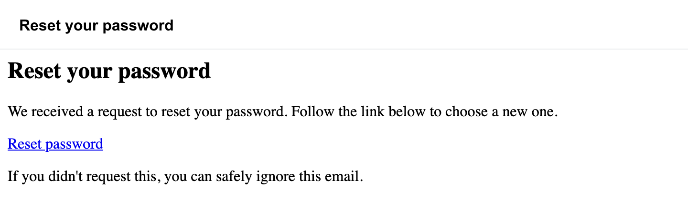
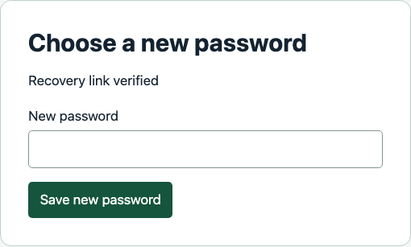

# Test Supabase password recovery with Playwright and a real email

A password recovery link can open a valid session before the user has changed their password. This example tests the entire journey with one new staging account. It confirms the original password works, follows Supabase's recovery email, saves a different password, and tries each password in a fresh Chromium context. After the successful login, the app reloads and reads the account from Supabase so the test can compare the email address.

## Configure the sender and callback

In a dedicated Supabase staging project, enable email/password signup and email confirmations. Configure custom SMTP with a sender that can deliver to new test inboxes. Add `http://localhost:3000/` as an allowed redirect and set the Site URL to `http://localhost:3000`. Both the **Confirm signup** and **Reset password** email templates must include the Supabase verification link (`{{ .ConfirmationURL }}`). [Supabase password-based Auth](https://supabase.com/docs/guides/auth/passwords) · [Custom SMTP](https://supabase.com/docs/guides/auth/auth-smtp)

Use Node.js 22.12 or newer and an available local port 3000. From this example's directory:

```sh
npm ci
npx playwright install chromium
cp .env.example .env.local
```

Set `VITE_SUPABASE_URL` and `VITE_SUPABASE_PUBLISHABLE_KEY` in `.env.local`. Supply `MAILSLURP_API_KEY` to the Node runner in that file or via its environment. Only the public Supabase settings use the Vite prefix. The test runner needs permission to create, read and delete a test inbox.

```sh
npm test
npm run test:staging
```

The first command checks the link selector offline. The staging command starts the local app and sends two real emails. It uses the signup link to confirm a new account and the recovery link to replace its password. Use `AUTH_EMAIL_COOLDOWN_SECONDS` for a longer per-address cooldown if your staging project requires it. The default is 65 seconds.

## See what a recovery session proves

The browser requests the email using `auth.resetPasswordForEmail(email, { redirectTo })`. The runner waits in the mailbox created for this test, selects a fresh link for the expected project, callback and action, and opens it in the browser that requested it. The browser exchanges the callback code using PKCE. A recovery exchange displays the new-password form. [Browser implementation](app.js) · [Link selector](test/links.js)



The form calls `auth.updateUser({ password })` and offers sign-out after the update succeeds. The staging test discards the recovery browser, checks the **old password is rejected** and the **new password is accepted** in separate, initially signed-out contexts. It compares the fresh account email after reload with the address used for signup. [End-to-end test](test/staging.spec.js)



The runner generates both passwords in memory, signs out on the successful path and deletes its test inbox in cleanup. Supabase retains the staging user. Remove test users periodically in that project. The example doesn't require an admin or service-role key.
